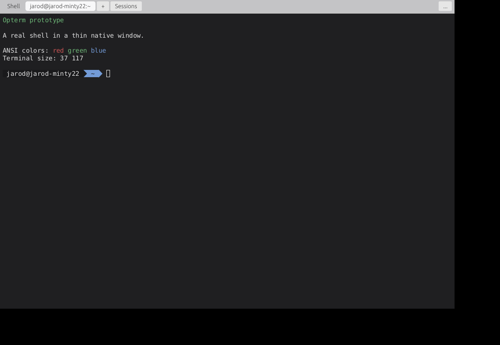
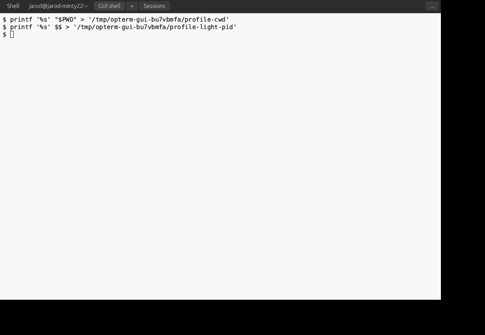
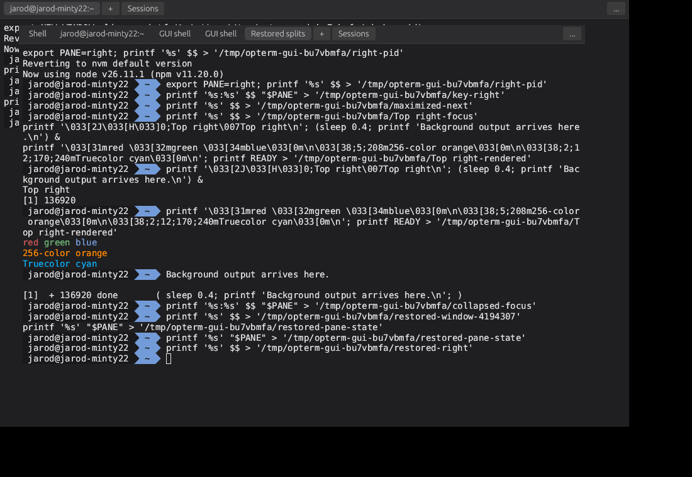

# Opterm

A lightweight cross-platform terminal for macOS, Linux, and Windows, with built-in session management for everyday shells and existing AI CLI agents.

## Current status

The Rust prototype runs a real local shell in the approved thin layout, with tabs, splits, multiple windows, resize, selection, copy/paste, and scrollback. A small background service now keeps shells and terminal programs alive when you close or crash the desktop. Reopening Opterm reconnects to those live sessions. Saved windows restore tabs, splits, names, sizes, and focus by reconnecting to existing work. Settings include appearance, launch profiles, per-profile terminal themes, TOML configuration, a last-valid recovery backup, custom settings/cache folders, and bounded saved output. No database is involved. See [prototype status and limitations](docs/prototype-status.md).

## Screenshots

These are actual captures of the running Linux X11 prototype, not design mockups. They were taken on an isolated display without a window manager, so native title bars are absent. They illustrate the implemented terminal, layouts, and settings; they do not establish macOS/Windows coverage or performance claims.

### Terminal



### Split panes


<details>
<summary>Appearance settings, profiles, themes, Light mode, and restored windows</summary>

### Appearance settings


### Launch profiles


### Terminal themes


### Light terminal theme



### Restored windows



</details>

## Operating guide

Read the [user guide](docs/user-guide.md) for everyday operation: opening tabs and splits, running agents, keeping sessions alive, profiles/themes, shortcuts, settings recovery, saved layouts, and troubleshooting. Check [delivery progress](docs/delivery-progress.md) for features still being completed and validated.

## Run locally

```sh
cd /home/jarod/Dev/extdev/projects/opterm
cargo run --release
```

After the first build, launch directly:

```sh
./target/release/opterm
```

Close the window and run the same command again to return to your shells. Start an installed agent from a shell as usual (`codex` or `claude`), or create a new agent session directly:

```sh
./target/release/opterm -- codex
```

An explicit program creates a fresh window/session; reopening with no program restores saved windows and their existing sessions. The **Sessions** menu reattaches detached tabs. Cmd+W (macOS) or Ctrl+Shift+W (Linux/Windows) detaches the focused pane (the tab closes when its last pane is detached). **End session…** in the menu stops its work after confirmation. Use **New window** to open a fresh default-profile session. Already-open saved windows are not duplicated; a session controlled elsewhere stays read-only until you choose **Take control**.

Splits keep the thin layout, with draggable dividers and a subtle outline around the focused pane. Each new pane starts a separate session using the default profile. Click a pane or use the focus shortcuts below; keyboard input and copy/paste use the focused pane. Closing a pane collapses its split and detaches its session. **Detach tab** in the menu detaches all its panes.

| Action | Linux / Windows | macOS |
| --- | --- | --- |
| Settings | Ctrl+Shift+, | Cmd+, |
| New window | Ctrl+Shift+N | Cmd+N |
| Split right | Ctrl+Shift+E | Cmd+D |
| Split below | Ctrl+Shift+O | Cmd+Shift+D |
| Focus another pane | Ctrl+Shift+Arrow | Cmd+Alt+Arrow |
| Resize nearest divider | Ctrl+Shift+Alt+Arrow | Cmd+Alt+Shift+Arrow |
| Maximize / restore pane | Ctrl+Shift+Enter | Cmd+Shift+Enter |
| Detach focused pane | Ctrl+Shift+W | Cmd+W |

Terminal output supports ANSI colors, the 256-color palette, and 24-bit RGB. New sessions advertise `TERM=xterm-256color` / `COLORTERM=truecolor` and remove an inherited `NO_COLOR` flag from development launchers. Programs choose their text colors; plain shell output remains plain. Existing shells keep their environment: run `unset NO_COLOR` (POSIX shells) to enable color for subsequently launched programs. Existing programs may need their own color setting or a normal restart; Opterm does not restart them.

Open **… → Settings…** to adjust app appearance, monospace font, size, padding, line height, and cursor. **Save** applies changes without restarting shells; **Cancel** discards the draft. Invalid TOML edits keep your working settings and good recovery copy. **Restore last valid settings** loads the backup for review; click **Save** to restore it. See [settings locations and recovery behavior](docs/settings-foundation.md).

In **Settings → Profiles**, create shell/agent presets with executable, arguments, starting folder, environment, and a terminal theme. Choose a default, right-click **+** to select a profile, or use the profile menus for tabs/splits. Neutral Dark/Light themes and custom colors are supported. Saving a profile affects new launches; editing its chosen theme updates live views without restarting programs. Marked secret environment values are omitted from the backup and must be reentered after recovery. See [profiles and themes](docs/profiles-themes.md).

In **Settings → Shortcuts & clipboard**, edit action bindings, explicitly unbind conflicting actions, or reset platform defaults. Save applies bindings immediately and preserves the settings backup. Copy-on-select is optional and initially off. F1–F20 and standard modified keys reach terminal programs. Mouse-aware programs receive clicks, dragging and wheel input; hold Shift to select or scroll locally. Native paste preserves text and line breaks without adding Enter.

Press Cmd+F (macOS) or Ctrl+Shift+F (Linux/Windows) for compact literal scrollback search. Enter finds the next match; Shift+Enter finds the previous one; Escape closes the row. Drag tabs to reorder them. Right-click a tab to move its entire split layout to another window, or drag it outside the window to create one. Transfers preserve running processes and manual names; a failed or timed-out handoff keeps the source tab.

In **Settings → Sessions & history**, control saved-output recording and retention, stage a custom settings/cache folder for the next launch, or clear disposable cache. The recovery backup remains separate. The session menu can pause/resume recording without stopping work. See the [storage guide](docs/user-guide.md#saved-output-and-storage-folders).

Windows save their own tabs, splits, names, size, and focus. Reopening restores their arrangement and reconnects surviving sessions. Unavailable work remains visible without command replay or replacement shells. Toggle restoration under **Settings → Sessions & history**, or use `--no-restore` for one fresh launch. See [saved layouts and recovery behavior](docs/saved-layouts.md).

The service stays running when all windows close. Rebuilding the app leaves an existing service running its current code to preserve work. Older services remain usable but may lack profile/theme support or the identity required for safe saved-layout reattachment until deliberately upgraded after work finishes. After finishing its sessions, deliberately stop it to load the rebuilt service on the next launch. To deliberately stop it and end **all** its sessions:

```sh
./target/release/opterm --stop-service
```

Use an installed Rust toolchain and a native desktop session. The first build downloads dependencies. Linux X11 is tested; macOS, Windows, and Wayland runtime behavior remains unverified. Reboot, logout, or service failure can end work; this prototype does not replay old commands or restore lost processes.

## Project documents

- [User guide: how to operate Opterm](docs/user-guide.md)
- [Settings files and last-valid recovery](docs/settings-foundation.md)
- [Launch profiles and terminal themes](docs/profiles-themes.md)
- [Saved windows, tabs, and splits](docs/saved-layouts.md)
- [Ordered delivery progress](docs/delivery-progress.md)
- [Product brief](docs/product-brief.md)
- [UI, settings, and first-version specification](docs/ui-settings-spec.md)
- [Terminal-first prototype plan](docs/prototype-plan.md)
- [Decision history](docs/design.md)
- [Approved layouts and historical mockups](docs/design/mockups/README.md)
- [Glossary](GLOSSARY.md)

## Implementation direction

Use Rust for the shared core and independent background session service. Follow the accepted thin terminal layout and implement standard windows, tabs, splits, profiles, themes, shortcuts, settings, and detach/reattach workflows. Evaluate the UI toolkit through a working terminal slice and native platform checks.

Start with simple configuration, layout, and bounded history files. SQLite, a durable direct-command ledger, public execution API/JSON CLI/MCP integration, and indexed history/export are deferred from the first usable version.

Live sessions can survive closing or crashing desktop views while the background service remains alive. This does not promise arbitrary process survival through reboot or service failure, and commands must not be automatically replayed.

Opterm uses independent styling. Historical other-product design references are retained only as design records and must not become application dependencies or shipping assets.
