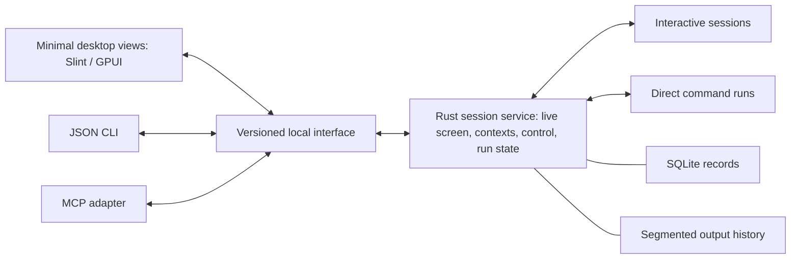

# Opterm prototype plan

**Terminal-first prototype plan as of 2026-10-09, with the prior backend-first draft preserved below.** The user confirmed the terminal-focused goal and prioritized UI, settings, and a minimal first version before more backend complexity. The active sequence below reflects Q54-Q83; the earlier direction through Q53 is retained in a clearly marked historical section. Begin with the [product brief](product-brief.md) and [UI/settings draft](ui-settings-spec.md). Project terminology is defined in [the glossary](../GLOSSARY.md).

## Active terminal-first prototype sequence

The design interview is closed with Q54-Q83 accepted. No further product decision round is required before a prototype. This sequence supersedes the backend-first implementation order retained below as history; the first working-terminal slice is implemented as recorded in [prototype status](prototype-status.md), while the remaining milestones are ahead.

1. **A working terminal view.** Establish the Rust project and a bounded evaluation of the existing PTY/VT and UI candidates. Render a real shell in the accepted thin layout; verify typing, resize, copy/paste, and a CLI agent. Choose the toolkit using this working slice and native feasibility, without claiming speed superiority.
2. **Built-in session continuity.** Add the independent session service, detach/reattach, and a compact session picker. Demonstrate that closing or crashing the desktop leaves service-owned work running; never replay commands after reboot or service failure.
3. **Everyday terminal controls.** Complete multiple windows/tabs, both split orientations, moving/renaming tabs, shortcuts, profiles, themes, and the accepted settings UI/TOML/recovery behavior. A smaller development slice does not satisfy the full first-version scope.
4. **Bounded saved state.** Add simple layout/history files, recording controls, accepted retention limits, custom storage, and safe settings recovery. Keep SQLite, the direct-command ledger, public execution API/JSON CLI/MCP, and indexed history/export deferred.
5. **Native validation and measurement.** Check the implemented behavior on Linux, macOS, and Windows and compare startup, input/output, and reattachment with matched baselines. Set resource budgets and resolve remaining technical choices from results; clearly mark unavailable platform coverage.

Ordinary reversible interface choices are implementation work, not additional interview rounds. Bring back only material scope changes or tradeoffs demonstrated by the prototype.

## Historical backend-first plan

The sections below preserve the earlier plan for context. They are not the active first-version implementation order.

## Review before implementation

The intended product is a fast, lightweight everyday terminal that makes hosting existing CLI agents and returning to live sessions straightforward. The prior plan emphasized durable command bookkeeping and storage before specifying that experience.

Complete the UI workflows, concrete layout/visual specification, and settings behavior before returning to implementation confirmation. Q54 now accepts the terminal-first scope in the [UI/settings specification](ui-settings-spec.md), including multiple windows/tabs, both split orientations, session profiles, custom profile themes, shortcuts, and tab renaming. SQLite, durable command bookkeeping, public execution interfaces, and indexed history/export are deferred from that first usable version. Live-session continuity still comes from the independent service; basic saved files do not claim the deferred durability guarantees. The sequence below remains historical.

## Intended result

Build an evaluated Rust session service, agent interfaces, and comparable minimal Slint/GPUI terminal views. Establish whether the architecture reduces session startup, command dispatch, output collection, and reattachment overhead while preserving correct execution and recovery behavior.

The service owns live work independently of the desktop. It provides interactive PTY sessions, direct executable/argument-array runs, task-scoped permissions, one controller per interactive session, and read-only screen inspection. Its initial implementation uses one process, SQLite bookkeeping, segmented output files, and framed local communication over Unix sockets or Windows named pipes.

The intended full product includes multiple windows, tabs, splits, detached-session management, scrollback search, and platform-appropriate keyboard/input/accessibility behavior. The first milestone evaluates the core and minimal views before completing that desktop feature set. Opterm itself works offline without a required account; hosted agents retain their own requirements.

## Implementation sequence

1. **Headless execution and contracts.** Establish the Rust workspace, candidate library adapters, local protocol, and JSON CLI. Implement on-demand service startup, task contexts and per-run capture, explicit executable/argument launches, separate direct-run stdout/stderr, submission-ID handling, permissions, outcome reporting, and managed-run cancellation. Specify schemas, limits, and deduplication expiry so expired identifiers never become replacement executions.
2. **Live sessions and history.** Evaluate portable-pty and alacritty_terminal. Maintain live terminal state while detached, provide current snapshots and incremental changes, enforce input/resize control, and reject stale controllers. Implement coordinated SQLite/output recovery, durable command bookkeeping, configurable retention, visible history gaps, recording controls, consistent export/deletion, and storage-degradation behavior. Verify these contracts before drawing conclusions about their speed.
3. **Comparable minimal views.** Connect Slint and GPUI views to the same service and terminal workload. Exercise attach/detach, text rendering, input, resize, workspace restoration, Unicode/CJK input methods, keyboard access, and screen-reader access to terminal text. Keep rendering limited to visible panes and document incomplete compatibility coverage individually.
4. **Agent and platform integration.** Exercise the JSON CLI and MCP adapter with a deterministic client and host at least two existing CLI agents. Validate continuity, observation, takeover, and reconnection without equating hosting with adoption of the execution API. Run native lifecycle, input, accessibility, and cancellation checks across the agreed matrix; explicitly record coverage that remains unavailable.
5. **Measurement and selection.** Run matched baselines and failure scenarios, deliver runnable source/local artifacts and a reproducible report, then conduct the evidence-based selection round. Choose the final toolkit/dependencies, minimum OS versions, and numeric performance/resource budgets from the results.

These steps organize the accepted work rather than introduce new product requirements. Prototype schemas and implementation choices can evolve during evaluation while retaining the accepted behavioral contracts. Opterm-owned code uses MIT OR Apache-2.0; dependency notices and selected distribution terms require review before shipping.

## Required behavior to demonstrate

| Scenario | Expected behavior | Decisions |
| --- | --- | --- |
| Close a tab/pane or close/crash the desktop | Detach the view; live service-owned work continues and can be reattached | Q3, Q35, Q48 |
| Reattach after output expiration | Receive the current live screen; report unavailable historical ranges explicitly | Q25, Q26, Q35, Q49 |
| Lose a response and resubmit the same ID | Recover the original run or report expired/unknown state; changed parameters are rejected | Q16, Q24, Q37 |
| Observe, take control, disconnect, reconnect | Observation cannot send input or resize; one controller operates at a time; stale control is rejected | Q17, Q30, Q31, Q35 |
| Change task context while runs are active | Accepted runs retain their captured directory/environment; later submissions receive the new context | Q15, Q34, Q50 |
| Request cancellation or observe program exit | Separate requested cancellation from verified termination, launch failure from nonzero exit, and outcome from transcript durability | Q29, Q52 |
| Output storage fails or an observer falls behind | Existing work continues where possible; gaps/degradation are visible; unsaved acceptance blocks new launches and unsaved completion is not acknowledged | Q24-Q26, Q39, Q40 |
| Restore after reboot/service failure | Restore saved metadata/history and expose ended/unknown work; never silently replay commands | Q3, Q16, Q28, Q34, Q48 |
| Export/delete history during live work | Produce a consistent historical export; deletion affects stored history and does not end work or promise erasure of a live screen | Q42 |
| Output requests clipboard access or link opening | Require a user gesture or explicit permission; deny such desktop actions by default headlessly while preserving ordinary terminal replies | Q51 |
| An update becomes available during live work | Stage the service update until idle or deliberate termination of that work | Q43 |

Use deterministic fixtures and targeted failure injection for the execution and storage contracts. Tests must cover failure windows around acceptance, launch, completion, and separate output writes, including recovery without duplicate execution. A test suite cannot establish exactly-once effects for arbitrary external programs; report unknown state when the service cannot determine the result.

## Benchmark report

Compare each tested environment's default/native terminal, WezTerm, Alacritty, and a direct-process baseline where applicable. Record the actual application versions and configurations, including shell startup, fonts, terminal dimensions, recording settings, and workload. Mark unavailable or non-equivalent baseline features rather than implying they were compared.

Run the accepted scenarios at 1, 8, and 32 simultaneous sessions, with 100 as stress. Report sample counts, typical and tail latency, throughput, and resource usage for:

- Cold startup with a new service and usable terminal view; identify shell initialization separately.
- Warm startup/reattachment to existing work, including time to the current screen.
- Direct-command dispatch and result delivery, separating Opterm overhead from the program's computation.
- Output collection, terminal parsing, recording, observer delivery, and visible rendering under sustained output.
- Input/display latency with the instrumentation and measurement boundaries stated.
- Idle and loaded CPU/memory for the service, desktop, and terminal support processes, with hosted-program costs reported separately.
- Correctness and recovery during desktop failure, service failure, disconnects, stale control, cancellation, history expiration, slow observers, and storage failures.

Default output retention is configurable: 30 days, 5 GiB total output history, and 256 MiB per output stream. Queues and in-memory scrollback remain bounded; the report must identify observed recording gaps and degradation. Numeric speed and memory budgets follow the first results. Report workload-specific conclusions with their measurement limits.

## Native coverage and current prerequisites

| Target | Initial evaluation requirement | Current evidence |
| --- | --- | --- |
| Linux x86-64 | Native runs on X11 and Wayland | Local Linux x86-64 host and Rust tools verified; Opterm and display/input tests not yet run |
| macOS Apple silicon | Native process, rendering, input, and accessibility checks | Unverified |
| macOS Intel | Native process, rendering, input, and accessibility checks | Unverified |
| Windows x86-64 | Native process/PTY, rendering, input, and accessibility checks | Unverified |

Rust 1.98.0 and Cargo 1.98.0 are currently available locally; the project's pinned toolchain will be selected during implementation. Codex CLI and Claude Code executable paths are present and are initial local agent-test candidates, but authentication, interactive behavior, and integration remain untested. Native macOS/Windows execution coverage is still required; cross-compilation alone does not satisfy it.

Report shell/TUI, Unicode/CJK, keyboard, and screen-reader cases separately, preserving Q22's stable-release requirements. A prototype may expose incomplete coverage, but a platform or feature stays unverified until its corresponding checks pass. Linux/Windows ARM64 is deferred.

## Decisions after prototype evidence

- Final PTY/VT libraries and dependency versions, and the winning UI toolkit/renderer.
- Validated protocol/state schemas, frame and resource limits, deduplication metadata retention, and coordinated storage/export format.
- Numeric latency, throughput, and memory budgets, with documented correctness tradeoffs.
- Minimum supported OS versions and the stable compatibility matrix.
- Stable distribution formats, signing/notarization, and updater implementation after the stack is selected.

Polished installers, public publication, remote SSH/container sessions, provider-specific automation, language SDKs, optional history encryption, and stronger per-session service-crash isolation are outside this first evaluation milestone. Live work is promised to survive desktop failure, while arbitrary process survival through reboot or service failure is not promised.

## Planning status

The user accepted Q80-Q83 and requested an end to the extended interview on 2026-10-09. Product planning is sufficient for a prototype; no further design round is queued. The first working-terminal slice now exists. See [prototype status](prototype-status.md) for coverage; the independent service, settings backups, and comparative benchmarks are not implemented yet.
