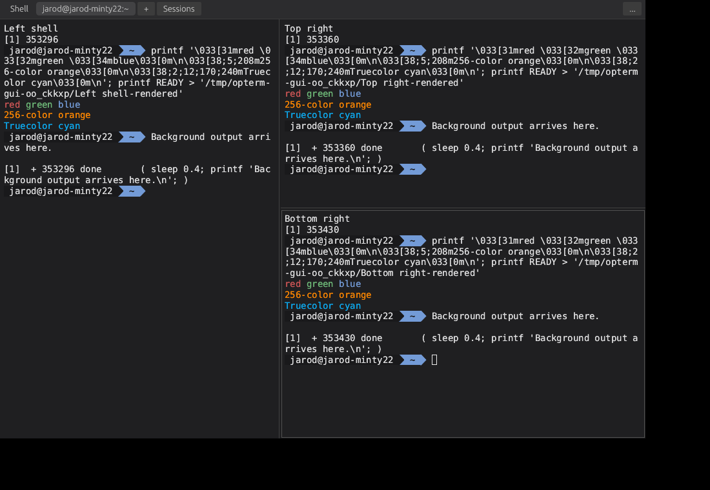
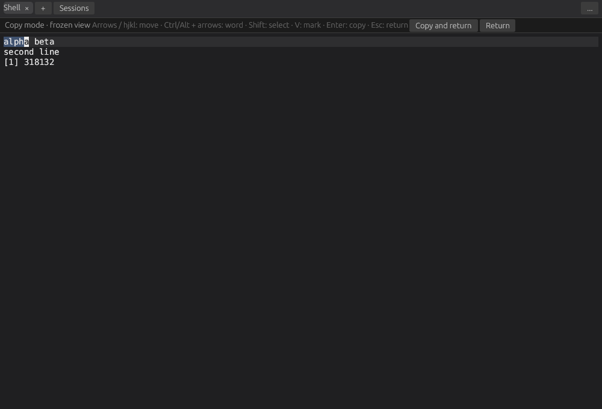
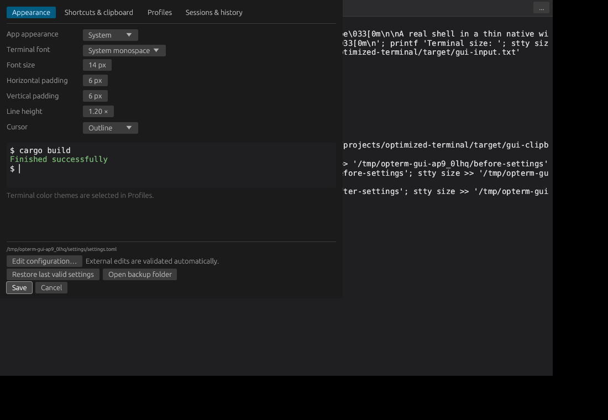
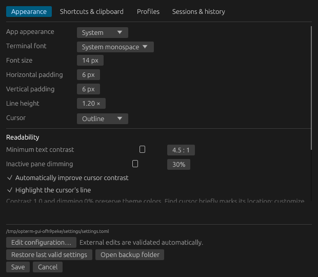
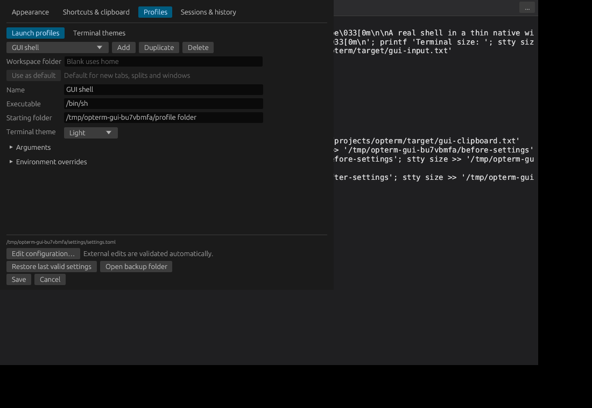
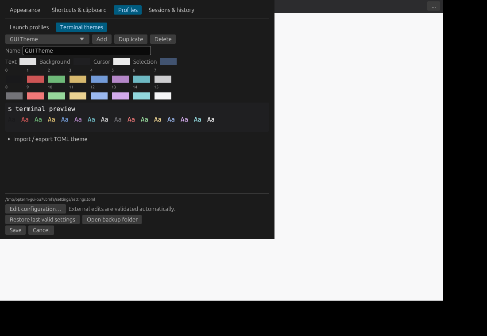

# Opterm user guide

Opterm is a native terminal for ordinary shells and installed AI CLI agents. Its background session service keeps programs running when you close the desktop, and saved layouts reconnect to that work when you reopen it.

This guide describes the current prototype. Linux X11 and a focused native Wayland check have passed. Native macOS/Windows build and PTY results are tracked separately from desktop acceptance in the [platform guide](platform-validation.md). Check [delivery progress](delivery-progress.md) for current validation and remaining platform work. The screenshots show real Linux app captures, not mockups.

## Start the terminal

From the repository root, build and launch:

```sh
cargo run --release
```

After building, launch the executable directly:

```sh
./target/release/opterm
```

On Windows, run `.\target\release\opterm.exe` in PowerShell. Windows operation still requires native validation.

An ordinary launch restores saved windows and reconnects surviving sessions. On a fresh setup, it opens a default-profile shell. To start a fresh window explicitly:

```sh
./target/release/opterm --new-window
```

For one fresh launch without changing the saved restoration preference:

```sh
./target/release/opterm --no-restore
```

## Tabs, windows, and splits

| Task | How to do it |
| --- | --- |
| Open a tab | Click **+**, use **… → New tab**, or press the New tab shortcut |
| Choose a profile for a new tab | Right-click **+**, or use **… → New tab with profile** |
| Open another window | Use **… → New window**, or the New window shortcut |
| Split side by side | Use **… → Split right** |
| Split top and bottom | Use **… → Split below** |
| Choose a profile for a split | Use **… → Split right with profile / Split below with profile** |
| Focus a pane | Click it, or use a focus shortcut |
| Resize a split | Drag its divider, or use a resize shortcut |
| Temporarily expand a pane | Use **… → Maximize / restore pane**; repeat to restore its arrangement |
| Rename a tab | Double-click it, or use **… → Rename tab…**; a blank name restores automatic naming |
| Detach the focused pane | Use the Close current view shortcut, or **… → Detach pane** |
| Detach an entire split tab | Use **… → Detach tab** |

Each new split starts a separate process using the default profile. Typing, copy, and paste go to the focused pane. Detaching a pane collapses its split branch and leaves the process running.

In builds containing tab movement, drag a tab along the tab row to reorder it. Right-click it to move the whole tab, including its splits, to a new or existing window. Dragging outside the window can create another window; direct drag-to-window targeting depends on native position support. Use the context menu when positioning is unavailable. A failed or timed-out transfer leaves the source tab available.



## Run shells and AI agents

Type commands into a pane as you would in another terminal. For example, if the agent CLI is installed and configured:

```sh
codex
```

or:

```sh
claude
```

You can also launch an executable directly in a fresh window/session:

```sh
./target/release/opterm -- codex
./target/release/opterm -- claude
```

To run agents side by side, create a split and launch one agent in each pane, or choose agent profiles from the split menu. Profiles supply launch presets and labels; Opterm does not automatically identify an AI model, track an agent's internal subagents, or automatically create panes for them.

**Ctrl+C** sends a terminal interrupt with the default bindings. To leave work running, close the window or detach its pane instead of ending its session.

## Close, detach, reconnect, or end work

- **Close a desktop window:** its shells and agents continue in the independent service. Reopen Opterm to restore its saved arrangement and reconnect.
- **Detach a pane/tab:** remove its view while keeping its work alive. Use **Sessions**, the quick switcher, or **Undo close** to reopen it.
- **Read-only session:** another window controls its input. Choose **… → Take control** if you intend to make this window the controller.
- **End a session:** choose **… → End session…** and confirm. This stops its process; it is different from closing a view.

Continuity lasts while the service and processes remain alive. Reboot, logout, service failure, or explicit service shutdown can end work. Opterm does not replay commands or resurrect lost processes. Missing saved sessions appear as unavailable panes; detach them or explicitly start new work with **+**. Exited sessions can retain their screen for inspection until ended.

## Copy, paste, scroll, and search

Drag over terminal text to select it, then use Copy. Double-click a word, triple-click a logical line (including soft wraps), or hold **Alt** while dragging for a rectangular selection. Paste uses the focused pane and preserves clipboard text and line breaks without adding Enter. If pasted text already contains line breaks, the running shell or program decides how to handle them.

Copy-on-select is initially off. Enable it under **Settings → Shortcuts & clipboard** if desired. In mouse-aware terminal programs, clicks, drags, and wheel events go to the program; hold **Shift** to use local terminal selection or scrollback instead.

Press the Search scrollback shortcut to open the compact Find row. Choose literal text or **Regex**, and **Smart case**, **Case sensitive**, or **Ignore case**. Smart case ignores case unless the query contains an uppercase letter. The row shows the current match and count; visible matches are highlighted. **Enter / Next** advances, **Shift+Enter / Previous** goes backward, and **Escape / ×** closes Find. Search wraps around.

Choose **All sessions** to show matching sessions and output previews. This scan does not change another session's selection, scroll offset, or input controller. Click a result to focus a local pane or reconnect its existing session. A session controlled in another window opens as an observed view; use **Take control** explicitly before navigating its scrollback.

Search uses bounded live scrollback, including retained ended-session output. It has scan, match, and time limits; a **+ / bounded** indicator means the count is a lower bound, not a complete total. It does not search saved output files or build a history index. Older running services retain literal, case-sensitive Find until deliberately upgraded after their work is finished.

## Keyboard copy mode

Choose **… → Keyboard copy mode** or its shortcut. Opterm freezes a bounded snapshot of the visible terminal while the service and shell keep running. The compact banner identifies the mode. Use arrows or **h/j/k/l**, **Ctrl/Alt+Left/Right** for words, **Home/End**, and **PageUp/PageDown**. Hold **Shift** to extend a selection or press **V** to toggle a mark. **Enter** copies the selection (or current line when nothing is selected) and returns to live input; **Escape** returns without copying. The banner also provides buttons for both actions.

Copy-mode keys stay out of the shell. The snapshot covers the viewed screen rather than all retained scrollback; scroll to the desired text before entering. It is capped at 65,536 cells and 1 MiB, with a visible notice if truncated.



## Clickable links

Hold **Ctrl** on Linux/Windows or **Cmd** on macOS and click a recognized link to open it with the system application. Right-click it for **Open link** or **Copy link**. Opterm recognizes supported OSC 8 hyperlinks, detected HTTP/HTTPS and mail links, local file URLs, and absolute file paths. Soft-wrapped visible links can be recognized across rows. Only an explicit click or menu action opens a target.

When a TUI owns the mouse, hold **Shift** as well to use local link/selection gestures. Relative file paths resolve only when opt-in shell integration supplies a validated local working directory through OSC 7. Opterm does not guess the directory from the desktop or a profile's launch folder.

## Quick switching and Undo close

Open **Sessions → Quick session switcher…**, **… → Quick session switcher…**, or the shortcut below. Type words from a session title, manual tab name, or profile. The picker orders sessions by recent use in this window. Use **↑ / ↓**, **Enter**, and **Escape**, or click a result. Existing local panes are focused; detached sessions reconnect without starting another shell. Other windows' sessions open as clearly labeled observed views and keep their existing input controller.

Choose **Sessions → Undo close**, **… → Undo close**, or its shortcut to reopen the last closed tab or pane. Opterm keeps up to **20** recent closes in this window's memory; this list clears when the desktop closes. Undo restores the original service/session references, manual name, focus, and split layout. If the remaining panes have since changed, the closed branch reopens separately instead of replacing those changes or duplicating views.

Surviving sessions reconnect; ended sessions show retained output; unavailable sessions remain explicit unavailable panes. Undo never reruns commands or resurrects a process.

## Default keyboard shortcuts

These are defaults; saved custom bindings take precedence. **Alt** is the Option key on macOS.

| Action | Linux / Windows | macOS |
| --- | --- | --- |
| New tab | Ctrl+Shift+T | Cmd+T |
| New window | Ctrl+Shift+N | Cmd+N |
| Detach focused pane | Ctrl+Shift+W | Cmd+W |
| Copy / paste | Ctrl+Shift+C / Ctrl+Shift+V | Cmd+C / Cmd+V |
| Search scrollback | Ctrl+Shift+F | Cmd+F |
| Quick session switcher | Ctrl+Shift+P | Cmd+P |
| Undo close | Ctrl+Shift+Z | Cmd+Shift+T |
| Keyboard copy mode | Ctrl+Shift+Space | Cmd+Shift+Space |
| Find cursor | Ctrl+Shift+J | Cmd+Shift+J |
| Previous / next prompt | Ctrl+Alt+PageUp / PageDown | Cmd+Alt+PageUp / PageDown |
| Copy last command output | Ctrl+Shift+Alt+C | Cmd+Shift+Alt+C |
| Settings | Ctrl+Shift+, | Cmd+, |
| Split right | Ctrl+Shift+E | Cmd+D |
| Split below | Ctrl+Shift+O | Cmd+Shift+D |
| Focus another pane | Ctrl+Shift+Arrow | Cmd+Alt+Arrow |
| Resize nearest divider | Ctrl+Shift+Alt+Arrow | Cmd+Alt+Shift+Arrow |
| Maximize / restore pane | Ctrl+Shift+Enter | Cmd+Shift+Enter |

Open **Settings → Shortcuts & clipboard** to change a binding. Enter a chord such as `Ctrl+Shift+T` or `Cmd+D`; the settings editor uses `Comma` for the comma key. Clear a binding to disable it. Duplicate action bindings are rejected: explicitly unbind the other action before reassignment. **Reset defaults** restores platform defaults in the draft; **Save** applies them, while **Cancel** discards the change. Next tab and Previous tab are available for assignment but have no default binding. Existing settings gain new action defaults only when those keys are unclaimed; explicit custom or empty bindings remain unchanged.

## Appearance settings

Open **… → Settings… → Appearance**. Adjust app appearance, installed monospace font, text size, horizontal/vertical padding, line height, and cursor shape. Application chrome can follow the system or use Dark/Light. Terminal colors come from the session's profile theme. **Readability** adds optional minimum text contrast, automatic cursor contrast, a cursor-line guide, and inactive-pane dimming. Defaults preserve the theme colors. **Find cursor** briefly marks the cursor with a ring.

Settings use a draft: **Save** validates, persists, and applies the changes; **Cancel** or closing Settings discards the draft. Appearance changes do not restart shells or agents.





## Prompt-aware shell integration

Bash and zsh integration is explicit and opt-in. Source the bundled script in the shell you want to enhance; Opterm does not edit startup files. For a default Linux installation:

```sh
# In Bash:
source ~/.local/share/opterm/shell-integration/opterm.bash
# In zsh:
source ~/.local/share/opterm/shell-integration/opterm.zsh
```

Use **Previous prompt**, **Next prompt**, and **Copy last command output** from the terminal menu or shortcuts. Copies exclude echoed input and prompts, preserve hard line breaks, and join soft wraps. Metadata stays bounded in live memory. Resize or destructive terminal edits invalidate old boundaries; a fresh prompt restores tracking. See [supported shells, marker limits, and setup details](shell-integration.md).

## Native accessibility

The terminal exposes its title, viewed text, caret, selection, and focus through AccessKit's native accessibility bridges. Text updates are coalesced and bounded to 128 rows, 512 columns, and 32 KiB. Active-output notices are throttled; output does not move focus. Icon-only terminal controls have descriptive labels.

Automated Linux AT-SPI checks ran with Orca active and confirmed readable text, caret, focus, and selected-word ranges. Audible screen-reader usability, VoiceOver, NVDA, and native macOS/Windows behavior still require platform checks.

## Performance evidence

See [the current priority measurements](performance-current-priorities.md) for matched release-build startup, input latency under output, throughput, resize, CPU, and memory evidence. Private-display software-renderer measurements do not establish real-GPU or cross-platform superiority.

## Launch profiles

Open **Settings → Profiles → Launch profiles**.

1. Click **Add**, or select a preset and **Duplicate** it. Duplicate the protected built-in Shell to customize it.
2. Give it a name and an executable, such as `codex`, `claude`, or an installed shell. A blank executable uses the default system shell.
3. Expand **Arguments** when needed. Each row is one argument; spaces within a row remain part of that argument. Opterm does not interpret the rows as a shell command.
4. Set a **Starting folder**, or leave it blank to use the workspace folder and then home. Use an absolute path or a path beginning with `~`.
5. Add environment overrides if needed and choose a terminal theme.
6. Click **Use as default** if this should launch from ordinary **+**, New window, and split shortcuts. Click **Save** to apply the draft.

Profile edits affect new launches. Existing processes retain their executable, arguments, folder, environment, and chosen theme. Deleting a profile does not stop its running sessions; deleting the default preset falls back to built-in Shell.

Mark an environment value **Secret** to hide it in the editor and exclude its value from the recovery backup. The active private TOML still stores it in plaintext. After restoring a backup, reenter marked values before launching that profile. Arguments do not have secret markers.



## Terminal themes

Open **Settings → Profiles → Terminal themes**. Dark and Light are protected built-in themes. Duplicate one or add a custom theme, then edit foreground, background, cursor, selection, and the 16 ANSI colors. Choose it in a launch profile and **Save**.

Editing a theme updates sessions using it without restarting their programs. Programs can also specify their own RGB colors or palette overrides. Deleting a theme falls back to Dark while keeping work running.

Expand **Import / export TOML theme** to enter a full file path. Import adds a validated theme to the draft; Save applies it. Export writes a new file and preserves existing files. See [the theme format and limits](profiles-themes.md).



## Restore settings or saved layouts

Use **Edit configuration…** in Settings to open the active TOML file. Valid external changes apply automatically. Invalid edits keep the current settings and the last-valid recovery copy, with an error explaining the file location. If another edit conflicts with an open draft, choose **Reload file** or explicitly **Replace file with my draft**.

To recover settings:

1. Open Settings and click **Restore last valid settings**.
2. Review the recovered draft. This does not overwrite the active file yet.
3. Click **Save** to restore it, or **Cancel** to leave the active file untouched.

**Open backup folder** shows the separate recovery location. Failed saves keep the draft available for correction and retry. Marked secret values require reentry after recovery. See [settings locations and backup behavior](settings-foundation.md).

Window restoration is controlled under **Settings → Sessions & history**. It preserves window arrangements and reconnects existing sessions, including tabs, split ratios, names, size, and focus. Turning it off does not delete saved layouts. Layout files contain session references and geometry, not commands or transcripts; see [saved layouts](saved-layouts.md).

## Saved output and storage folders

**Settings → Sessions & history** controls live scrollback, output recording, retention days, total storage, and the per-stream limit. Defaults are 10,000 scrollback lines, recording on, 30 days, 5 GiB total, and 256 MiB per stream. Wide terminals also cap history at one million cells. This bounds the grid allocation, not total process memory (Unicode extras and hosted programs can allocate separately). Saved output is raw terminal bytes in private `.ansi` files under the session service's `history/` folder; it has no command index. Use **Open saved output folder** to inspect it. These files may contain private information printed by programs.

Use **… → Save this session's output** to pause/resume recording for the focused session. Global recording off overrides that control. Cleanup runs on output writes and roughly every minute while idle, removes expired/oldest closed streams, and preserves active files; reaching an active stream/total limit stops recording with a visible notice. The writer queues at most 1 MiB per session and batches up to 512 KiB. A full writer queue reports omitted bytes. Shells continue running through recording failures. Paused periods are intentionally absent. Recording errors and gaps remain visible in the session menu.

For a custom settings/cache location, save your settings, enter an absolute **Custom Opterm folder** or use **Browse…**, then select **Use folder on next launch**. Validated saved settings are copied into `settings/settings.toml`; differing existing destination settings are preserved and reported. Original files remain. Close/reopen the desktop to activate the remembered folder; live sessions and their history stay in their existing service location. The last-valid backup stays separately in normal application data (or the recovery override).

**Clear cache** removes only files owned by Opterm in its marked disposable cache folder. Settings, output, saved layouts, backups, and sessions remain. An unavailable chosen folder displays recovery/choose-location instructions and never silently activates another location. Environment path overrides are intended for isolated development/testing; `OPTERM_CONFIG_DIR` disables remembered-folder selection.

Saved output is separate from live scrollback and does not restore lost processes or replay commands. Older services remain live but cannot provide recording controls; upgrade deliberately after finishing their work.

## Common problems

| Symptom | What to check |
| --- | --- |
| An executable will not launch | Confirm it is installed and available on PATH, or use its full path in the profile. Check arguments and the reported error. |
| A starting folder is unavailable | Correct the profile/workspace path. Opterm reports the error instead of silently changing folders. |
| A profile recovered from backup will not launch | Reenter any marked secret environment values. |
| A pane is read-only | Another window controls it; use **Take control** deliberately. |
| A restored pane is unavailable | Its original process/service no longer exists. Close that view or start new work explicitly. |
| Settings will not save | Read the reported path/error, correct permissions or the destination, then retry. Recovery directories must remain private to the current user. |
| Terminal text has no colors | The program chooses whether to emit color. New sessions enable terminal color capability; in an existing POSIX shell, `unset NO_COLOR` can enable color for subsequently launched programs. Check explicit profile overrides too. |
| New features report an older service | Rebuilding the desktop does not replace a live service. Finish its work before deliberately upgrading it. |

## Update the background service after rebuilding

Rebuild normally with `cargo build --release`. Appearance/shortcut changes can apply to existing work, but new service capabilities require a service started by the updated binary. Opterm leaves an older live service running to preserve its sessions.

**Only after its work is finished**, deliberately stop that service and reopen:

```sh
./target/release/opterm --stop-service
./target/release/opterm
```

`--stop-service` ends **all** sessions in the selected service. To test separately, `OPTERM_STATE_DIR` can select an isolated service directory. Keep the same value across its desktop launches to reconnect. Settings and backup locations have separate development overrides; consult [settings documentation](settings-foundation.md) before changing them.

## Tab close, drag and snap

Click the **×** at the right of a tab to close its entire view, including splits. Its running sessions remain available from **Sessions**. Closing an inactive tab keeps the current tab active. Right-click anywhere on a tab for rename, splits, close, or movement to another window.

Drag a tab within the strip to reorder it; the blue line marks its insertion position. The strip scrolls horizontally when tabs no longer fit. Drag outside the window to create another window, or drop over another open Opterm window to move the tab there. Cross-window drop targets rely on absolute window positions, which Wayland does not provide; use the right-click menu there.

To snap one tab beside another, select the destination tab and drag the other tab onto an edge of its terminal pane. Alternatively, hold the dragged tab over its destination tab for about half a second to activate it first. A shaded half-pane preview marks left, right, top or bottom placement. Releasing merges the existing sessions and any source splits into the destination layout. It does not start replacement shells. Dropping in the middle cancels the snap.

Plain **Tab** and **Shift+Tab** stay terminal input while a terminal is active; the toolbar does not use them for focus navigation. Tab navigation in Settings stays available.

For the custom app icon and application-menu installation, see [app icons and desktop installation](app-icons.md).
